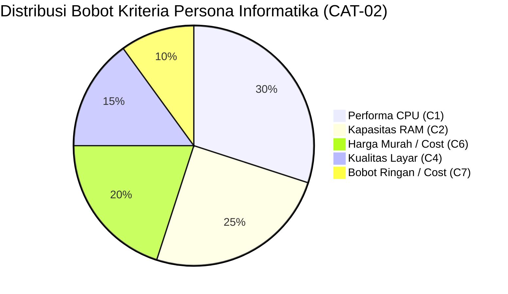
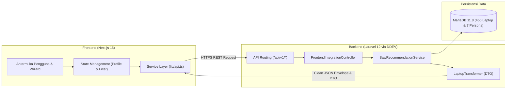

<p align="center">
  
</p>

<h1 align="center">💻 CariSpek — Sistem Pendukung Keputusan (SPK) Rekomendasi Laptop</h1>

<p align="center">
  <strong>Platform Cerdas Pemilihan & Rekomendasi Laptop Berbasis Profil Kebutuhan, Anggaran, & Algoritma Simple Additive Weighting (SAW)</strong>
</p>

<p align="center">
  <a href="#-susunan-tim-pengembang-kelompok-7a"></a>
  <a href="#-arsitektur-dan-stack-teknologi"></a>
  <a href="#-arsitektur-dan-stack-teknologi"></a>
  <a href="#-fondasi-ilmiah-algoritma-spk-simple-additive-weighting-saw"></a>
  <a href="#-pengujian-sistem--automated-tests"></a>
</p>

---

## 📌 Daftar Isi
1. [Tentang CariSpek](#-tentang-carispek)
2. [Susunan Tim Pengembang (Kelompok 7A)](#-susunan-tim-pengembang-kelompok-7a)
3. [Fondasi Ilmiah Algoritma SPK: Simple Additive Weighting (SAW)](#-fondasi-ilmiah-algoritma-spk-simple-additive-weighting-saw)
   - [Konsep & Alasan Pemilihan Metode](#1-konsep--alasan-pemilihan-metode)
   - [Kriteria Penilaian (Benefit vs Cost)](#2-kriteria-penilaian-benefit-vs-cost)
   - [Tahapan Matematis Perhitungan SAW](#3-tahapan-matematis-perhitungan-saw)
   - [Matriks Pembobotan 7 Klaster Persona Mahasiswa](#4-matriks-pembobotan-7-klaster-persona-mahasiswa)
   - [Explainable Reasoning & Transparansi Skor](#5-explainable-reasoning--transparansi-skor)
4. [Dataset Perangkat (450 Unit Laptop & PC)](#-dataset-perangkat-450-unit-laptop--pc)
5. [Arsitektur & Stack Teknologi](#-arsitektur--stack-teknologi)
6. [Panduan Menjalankan Sistem Secara Lokal](#-panduan-menjalankan-sistem-secara-lokal)
7. [Struktur Repositori & Kontrak Dokumen](#-struktur-repositori--kontrak-dokumen)
8. [Pengujian Sistem & Automated Tests](#-pengujian-sistem--automated-tests)

---

## 📖 Tentang CariSpek

**CariSpek** adalah aplikasi Sistem Pendukung Keputusan (SPK) berbasis web yang dirancang khusus untuk membantu mahasiswa, akademisi, dan profesional di Indonesia menemukan perangkat komputer/laptop paling ideal sesuai dengan program studi, beban kerja perangkat lunak, dan batasan anggaran finansial.

Sering kali mahasiswa membeli laptop hanya berdasarkan rekomendasi penjual toko atau tren merek semata, yang berujung pada:
- **Spek Kurang (*Under-spec*)**: Komputer lambat saat kompilasi kode/rendering 3D.
- **Spek Terlalu Mahal (*Over-budget*)**: Membeli fitur berlebih yang sebenarnya tidak dibutuhkan.

CariSpek menyelesaikan masalah tersebut dengan menerapkan **metode MADM (Multi-Attribute Decision Making)** yang objektif, transparan, dan dapat dipertanggungjawabkan secara ilmiah melalui algoritma **Simple Additive Weighting (SAW)**.

---

## 👥 Susunan Tim Pengembang (Kelompok 7A)

Proyek ini dikembangkan dalam rangka pemenuhan tugas besar mata kuliah **Rekayasa Perangkat Lunak (RPL)**:

| Nama Anggota | Akun GitHub | Peran Utama & Tanggung Jawab |
| :--- | :--- | :--- |
| **Muhammad Affif** | [@Nourivex](https://github.com/Nourivex) / [@muhammadaffif](https://github.com/muhammadaffif) | **Project Lead & Backend/Data Engineer**<br>• Perancangan arsitektur sistem & basis data MariaDB.<br>• Implementasi algoritma SPK SAW dinamis & REST API.<br>• Data engineering katalog 450 laptop & matriks persona. |
| **Zakky Fawwaz** | [@zakyfawwaz701](https://github.com/zakyfawwaz701) | **System Analyst & Koordinator Dosen Pengawas**<br>• Penyusunan dokumen SRS (Software Requirements Specification).<br>• Analisis kebutuhan fungsional/non-fungsional & Use Case.<br>• Koordinasi bimbingan asistensi dengan dosen pengawas. |
| **Muhamad Fahren Andrean Rangkuti** | [@Renkaslana](https://github.com/Renkaslana) | **Frontend Developer (Next.js)**<br>• Implementasi antarmuka Next.js App Router, Tailwind CSS, & Zustand.<br>• Integrasi Wizard Kuesioner dengan REST API headless.<br>• Optimasi performa web & client-side caching. |
| **Yesa Prayugo** | [@yesaprayugo](https://github.com/yesaprayugo) | **UI/UX Designer & QA / Testing Lead**<br>• Perancangan Design System, Wireframe, & Prototyping Figma.<br>• Pembuatan aset 3D render laptop & arketipe visual produk.<br>• Pengujian kualitas antarmuka & kepatuhan aksesibilitas (WCAG). |
| **Dosen Pengawas** | [@redmousestudio](https://github.com/redmousestudio) | Dosen Pengawas & Evaluator Mata Kuliah RPL |

---

## 🧮 Fondasi Ilmiah Algoritma SPK: Simple Additive Weighting (SAW)

### 1. Konsep & Alasan Pemilihan Metode
Metode **Simple Additive Weighting (SAW)**, yang sering juga dikenal sebagai *metode penjumlahan terbobot*, adalah salah satu metode penyelesaian masalah Multi-Attribute Decision Making (MADM) yang paling populer, efisien, dan transparan.

Konsep fundamental SAW adalah **mencari penjumlahan terbobot dari rating kinerja pada setiap alternatif di semua kriteria**.

**Mengapa metode SAW dipilih untuk proyek CariSpek?**
1. **Transparansi Matematis Penuh (*Explainable AI*)**: Hasil rekomendasi tidak berupa *black box*. Pengguna dapat melihat secara persis mengapa laptop A terpilih, berapa kontribusi skor prosesornya, dan bagaimana bobot harga memengaruhi peringkat akhir.
2. **Efisiensi Komputasi Tinggi**: Kompleksitas komputasi linear $O(m \times n)$ memungkinkan penyaringan dan perangkingan 450 perangkat dalam waktu $< 50\text{ ms}$ langsung di backend.
3. **Fleksibilitas Bobot Berbasis Persona**: Setiap mahasiswa memiliki prioritas berbeda (misal: mahasiswa informatika memprioritaskan RAM & CPU, sedangkan mahasiswa sastra memprioritaskan harga murah dan baterai awet). SAW mengakomodasi kebutuhan ini melalui vektor bobot $W$ yang adaptif.

---

### 2. Kriteria Penilaian (Benefit vs Cost)
Sistem mengevaluasi setiap unit laptop berdasarkan 7 kriteria utama yang dibagi ke dalam dua sifat atribut:

| Kode | Nama Kriteria | Tipe Atribut | Satuan | Deskripsi & Bobot Logika |
| :---: | :--- | :---: | :---: | :--- |
| **$C_1$** | **Performa Komputasi (CPU)** | **Benefit** | Skor Index (0–100) | Menilai kekuatan prosesor berdasarkan benchmark PassMark/Geekbench single-core & multi-core. Semakin tinggi skornya, semakin baik. |
| **$C_2$** | **Kapasitas & Upgradability RAM** | **Benefit** | GB + Poin Bonus | Menilai kapasitas bawaan (GB) ditambah poin bonus jika RAM *dual-channel* atau memiliki slot ekspansi SODIMM. |
| **$C_3$** | **Kartu Grafis (GPU)** | **Benefit** | Skor Index (0–100) | Menilai kemampuan grafis terintegrasi (iGPU) atau discrete GPU (NVIDIA RTX / AMD Radeon) untuk tugas render 3D, AI, dan gaming. |
| **$C_4$** | **Kualitas Layar & Display** | **Benefit** | Skor Index (0–100) | Menilai resolusi (FHD/2K/OLED), panel IPS/OLED, akurasi gamut warna (100% sRGB), dan refresh rate (Hz). |
| **$C_5$** | **Daya Tahan Baterai & Portabilitas** | **Benefit** | Jam / Wh | Estimasi ketahanan baterai untuk mobilitas kuliah tanpa tergantung colokan listrik. |
| **$C_6$** | **Harga Pasar (Price IDR)** | **Cost** | Rupiah (IDR) | Nilai moneter yang harus dibayar. **Semakin murah harganya, nilai normalisasinya semakin tinggi (mendekati 1.0)**. |
| **$C_7$** | **Bobot Fisik Perangkat** | **Cost** | Kilogram (kg) | Berat fisik unit laptop. **Semakin ringan bobotnya, semakin nyaman dibawa ke kampus (skor normalisasi semakin tinggi)**. |

---

### 3. Tahapan Matematis Perhitungan SAW

#### Langkah 1: Pembentukan Matriks Keputusan ($X$)
Matriks $X$ berukuran $m \times n$ dibentuk dari $m$ alternatif laptop yang lolos batas fleksibilitas anggaran pengguna ($Price \le Budget_{max} \times 1.10$) dan $n$ kriteria:

$$
X = \begin{bmatrix}
x_{11} & x_{12} & \dots & x_{1n} \\
x_{21} & x_{22} & \dots & x_{2n} \\
\vdots & \vdots & \ddots & \vdots \\
x_{m1} & x_{m2} & \dots & x_{mn}
\end{bmatrix}
$$

*Di mana $x_{ij}$ menyatakan nilai kinerja alternatif ke-$i$ pada kriteria ke-$j$.*

#### Langkah 2: Normalisasi Matriks Keputusan ($R$)
Untuk menyamakan skala pengukuran dari kriteria yang memiliki satuan berbeda (Rupiah, Gigabyte, Kilogram, dll.), dilakukan normalisasi matriks $R = [r_{ij}]$ dengan formula:

$$
r_{ij} = \begin{cases}
\dfrac{x_{ij}}{\max\limits_{k} (x_{kj})} & \text{jika } j \text{ adalah kriteria keuntungan (Benefit)} \\[12pt]
\dfrac{\min\limits_{k} (x_{kj})}{x_{ij}} & \text{jika } j \text{ adalah kriteria biaya (Cost)}
\end{cases}
$$

* **Untuk Kriteria Benefit ($C_1, C_2, C_3, C_4, C_5$)**: Nilai kinerja dibagi dengan nilai maksimum dari seluruh alternatif pada kriteria tersebut.
* **Untuk Kriteria Cost ($C_6, C_7$)**: Nilai minimum dari seluruh alternatif dibagi dengan nilai kinerja alternatif yang bersangkutan.

#### Langkah 3: Penentuan Vektor Bobot ($W$)
Ditetapkan vektor bobot preferensi $W = [w_1, w_2, \dots, w_n]$ sesuai dengan persona jurusan atau preferensi pengguna, di mana total seluruh bobot bernilai 1 (atau 100%):

$$
\sum_{j=1}^{n} w_j = 1 \quad \text{atau} \quad \sum_{j=1}^{n} w_j = 100\%
$$

#### Langkah 4: Perhitungan Nilai Preferensi Akhir ($V_i$) & Match Score %
Nilai preferensi komprehensif ($V_i$) untuk setiap alternatif laptop ke-$i$ dihitung dengan menjumlahkan perkalian antara elemen matriks ternormalisasi ($r_{ij}$) dengan bobot kriterianya ($w_j$):

$$
V_i = \sum_{j=1}^{n} w_j \cdot r_{ij}
$$

Untuk kemudahan pemahaman pengguna di antarmuka web, nilai $V_i$ ($0.0 \le V_i \le 1.0$) dikonversi ke dalam persentase **Match Score %**:

$$
\text{Match Score}_i = \text{round}(V_i \times 100\%)
$$

---

### 4. Matriks Pembobotan 7 Klaster Persona Mahasiswa

Sistem menyediakan matriks bobot terstandarisasi untuk 7 persona mahasiswa (tersimpan pada tabel `criteria_weights`):



| Kode Persona | Klaster Target & Jurusan | Prioritas Utama | $w_{\text{CPU}}$ | $w_{\text{RAM}}$ | $w_{\text{GPU}}$ | $w_{\text{Layar}}$ | $w_{\text{Harga}}$ | $w_{\text{Bobot}}$ |
| :---: | :--- | :--- | :---: | :---: | :---: | :---: | :---: | :---: |
| `CAT-01` | **Dasar / Pelajar** *(Non-Teknik, Hukum, Sastra)* | Harga Hemat & Baterai Awet | 15% | 15% | 5% | 15% | **35%** | **15%** |
| `CAT-02` | **Multitasking & Coding** *(Informatika, SI, Data Science)* | CPU Cepat & RAM Besar | **30%** | **25%** | 10% | 15% | 15% | 5% |
| `CAT-03` | **Kreatif & Desain** *(DKV, Arsitektur, Animasi)* | Layar 100% sRGB & GPU Dedicated | 20% | 20% | **25%** | **25%** | 10% | 0% |
| `CAT-04` | **Gaming & Teknik Berat** *(Mesin, Sipil, 3D CAD)* | GPU Flagship & Pendingin Bagus | **25%** | 20% | **30%** | 15% | 10% | 0% |
| `CAT-05` | **PC Rakitan Hemat** *(Dormitory / Performa Maksimal)* | Rasio Performa per Rupiah | **35%** | 25% | 20% | 0% | 20% | 0% |
| `CAT-06` | **Mobilitas Medis & Klinis** *(Kedokteran, Farmasi)* | Bobot Enteng & Baterai Tahan Seharian | 15% | 15% | 0% | 20% | 20% | **30%** |
| `CAT-07` | **Komputasi Finansial & Bisnis** *(Akuntansi, Manajemen)* | CPU Multithread & Numpad Keyboard | 25% | 25% | 5% | 20% | 15% | 10% |

---

### 5. Explainable Reasoning & Transparansi Skor

Sistem tidak hanya memberikan nomor peringkat, melainkan membedah alasan rekomendasi:
1. **Best Match**: Alternatif dengan nilai $V_i$ tertinggi dari seluruh kandidat yang lolos filter.
2. **Best Value**: Alternatif yang menawarkan rasio performa tertinggi dengan harga paling efisien di bawah pagu anggaran.
3. **Breakdown Tiap Kriteria**: Nilai murni $r_{ij} \times 100$ per kriteria ditampilkan dalam bentuk progress bar.
4. **Trade-offs Transparan**: Menyajikan kelemahan komparatif perangkat (misal: *"RAM onboard tidak dapat di-upgrade"* atau *"Bobot 2.3 kg kurang nyaman dibawa jalan kaki"*).

---

## 📊 Dataset Perangkat (450 Unit Laptop & PC)

Basis data katalog CariSpek dikurasi langsung dari pasar komputer resmi Indonesia (2024–2026) melalui berkas `Data Spek Komputer & Laptop Mahasiswa 2026.xlsx`:

* **Total Entitas**: **450 Unit Perangkat**
* **Distribusi Jenis Perangkat**:
  - 💻 Laptop Standar (Clamshell): 363 unit
  - 🖥️ PC Rakitan Desktop: 42 unit
  - 🔄 Laptop 2-in-1 / Convertible: 25 unit
  - 📦 Mini PC: 10 unit
  - 🖥️ Desktop Branded (All-in-One): 10 unit
* **Distribusi 17 Merek Terkemuka**: Lenovo (87), ASUS (75), HP (64), Acer (52), Custom PC (42), MSI (30), Axioo (22), Dell (21), Apple (18), Advan (14), Gigabyte, Huawei, Xiaomi, Colorful, Infinix, Minisforum.
* **Rentang Harga Pasar**: Rp 2.349.000 s/d Rp 65.999.000 (Rata-rata: Rp 13,4 Juta).
* **Kelengkapan Fitur (19 Atribut)**: ID, Brand, Model Seri, Tipe, CPU, Benchmark, GPU, RAM, Upgradability, Storage SSD, Ukuran Layar, Gamut sRGB, Bobot, Harga, Link Marketplace, Status Garansi, Tag Usecase, Pros, Cons.

---

## 🏗️ Arsitektur & Stack Teknologi

Aplikasi menggunakan arsitektur modern **Headless Decoupled Architecture**:



* **Backend Engine**: PHP 8.4 + Framework Laravel (Service-Repository Clean Pattern).
* **Containerisasi & Dev Server**: **DDEV** (Nginx + PHP-FPM + MariaDB 11.8).
* **Frontend Web App**: Next.js 16 App Router (Turbopack, TypeScript, Tailwind CSS v4, Radix UI/shadcn, Motion).
* **Dynamic Branding SSoT**: Konfigurasi merek terpusat di `config/brand.php` dan `.env` tanpa hardcode nama sistem di logika kode.

---

## 🚀 Panduan Menjalankan Sistem Secara Lokal

### Prasyarat Sistem
- Docker & Docker Compose
- DDEV CLI (`v1.24+`)
- Node.js `v20+` & npm

### 1. Menjalankan Backend (Laravel + DDEV)
```bash
# 1. Pastikan Anda berada di direktori root repositori
cd "Rekayasa Perangkat Lunak"

# 2. Nyalakan container DDEV (otomatis menyalakan Nginx, PHP 8.4, & MariaDB)
ddev start

# 3. Jalankan migrasi dan seeder database 450 laptop (hanya saat setup pertama)
ddev artisan migrate:fresh --seed

# 4. Verifikasi status backend dan endpoint healthcheck
curl -k https://carispek-backend.ddev.site/api/v1/health
```

### 2. Menjalankan Frontend (Next.js)
```bash
# 1. Masuk ke direktori frontend
cd frontend

# 2. Install dependensi package
npm install

# 3. Jalankan server pengembangan
npm run dev
```
Buka browser Anda dan akses:
👉 **`http://localhost:3000`**

---

## 📁 Struktur Repositori & Kontrak Dokumen

```
├── .ddev/                         # Konfigurasi container lokal DDEV
├── app/
│   ├── Http/Controllers/Api/     # RESTful Controller (Device, Category, Recommendation)
│   ├── Models/                    # Model Eloquent (Device, Category, Brand, CriteriaWeight)
│   └── Services/
│       ├── SawRecommendationService.php  # Implementasi matematis algoritma SAW
│       └── LaptopTransformer.php          # DTO adapter ke format antarmuka Next.js
├── database/
│   ├── data/                      # JSON dataset resmi (categories.json & devices.json)
│   ├── migrations/                # Skema tabel basis data
│   └── seeders/                   # Seeder otomatis untuk 450 unit laptop
├── docs/                          # Spesifikasi & dokumen rekayasa perangkat lunak resmi
│   ├── ARCHITECTURE.md            # Arsitektur sistem, ERD, dan topologi jaringan
│   ├── API_CONTRACT_STANDARDS.md  # Standar JSON envelope respons & error handling
│   ├── api-design.md              # Rincian kontrak 40 endpoint REST API
│   ├── openapi.yaml               # Spesifikasi formal OpenAPI 3.1.0 (Swagger)
│   └── TESTING_GUIDE.md           # Panduan pengujian via Postman, Thunder Client, & cURL
├── frontend/                      # Repositori antarmuka Next.js App Router (Cabang UI)
├── AGENTS.md                      # Pedoman AI Coding Assistant & profil pengguna
└── README.md                      # Dokumentasi utama proyek
```

---

## 🧪 Pengujian Sistem & Automated Tests

Backend dilengkapi pengujian otomatis (*Automated Feature Tests*) untuk menjamin akurasi algoritma SAW dan kestabilan endpoint:

```bash
ddev artisan test
```

**Hasil Pengujian:**
```text
   PASS  Tests\Feature\ApiEndpointsTest
  ✓ config endpoint returns dynamic branding                             0.44s  
  ✓ health endpoint reports connected database                           0.17s  
  ✓ categories endpoint returns all seven personas                       0.17s  
  ✓ category detail returns specific persona                             0.17s  
  ✓ brands endpoint returns list of manufacturers                        0.17s  
  ✓ devices catalog returns paginated list                               0.17s  
  ✓ devices filtering works properly                                     0.17s  
  ✓ device detail returns single device specs                            0.17s  
  ✓ saw recommendation engine generates valid rankings                   0.19s  
  ✓ saw recommendation validates required fields                         0.17s  
  ✓ comparison endpoint compares multiple devices                        0.17s  

  Tests:    13 passed (51 assertions, 0 failures)
  Duration: 2.40s
```

---

<p align="center">
  Dibuat dengan dedikasi tinggi oleh <strong>Tim NEXORA (Kelompok 7A)</strong><br>
  Program Studi Teknik Informatika — Mata Kuliah Rekayasa Perangkat Lunak (RPL) 2026
</p>
