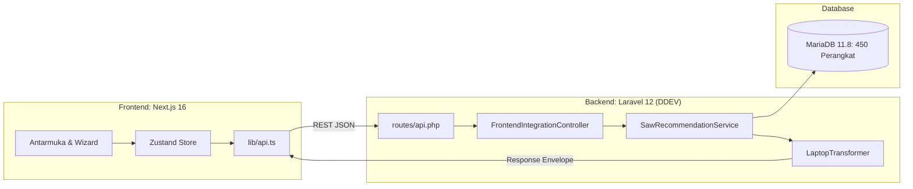

<p align="center">
  
</p>

<h1 align="center">CariSpek: Sistem Pendukung Keputusan (SPK) Pemilihan Laptop</h1>

<p align="center">
  <strong>Implementasi Algoritma Simple Additive Weighting (SAW) untuk Rekomendasi Laptop Berbasis Profil Jurusan dan Anggaran Mahasiswa</strong>
</p>

<p align="center">
  <a href="#susunan-tim-pengembang-kelompok-7a"></a>
  <a href="#arsitektur-dan-stack-teknologi"></a>
  <a href="#arsitektur-dan-stack-teknologi"></a>
  <a href="#fondasi-ilmiah-algoritma-spk-simple-additive-weighting-saw"></a>
  <a href="#pengujian-sistem-dan-automated-tests"></a>
</p>

---

## Daftar Isi
1. [Latar Belakang & Masalah](#latar-belakang--masalah)
2. [Susunan Tim Pengembang (Kelompok 7A)](#susunan-tim-pengembang-kelompok-7a)
3. [Fondasi Ilmiah Algoritma SPK: Simple Additive Weighting (SAW)](#fondasi-ilmiah-algoritma-spk-simple-additive-weighting-saw)
   - [Konsep Dasar Metode SAW](#1-konsep-dasar-metode-saw)
   - [Kriteria Penilaian (Benefit vs Cost)](#2-kriteria-penilaian-benefit-vs-cost)
   - [Tahapan Matematis Perhitungan](#3-tahapan-matematis-perhitungan)
   - [Studi Kasus Perhitungan Riil](#4-studi-kasus-perhitungan-riil)
   - [Matriks Pembobotan 7 Persona Mahasiswa](#5-matriks-pembobotan-7-persona-mahasiswa)
4. [Dataset Perangkat (450 Unit Laptop & PC)](#dataset-perangkat-450-unit-laptop--pc)
5. [Arsitektur dan Stack Teknologi](#arsitektur-dan-stack-teknologi)
6. [Panduan Instalasi & Eksekusi Lokal](#panduan-instalasi--eksekusi-lokal)
7. [Kebijakan Repositori & Percabangan Git](#kebijakan-repositori--percabangan-git)
8. [Pengujian Sistem dan Automated Tests](#pengujian-sistem-dan-automated-tests)

---

## Latar Belakang & Masalah

Pemilihan laptop untuk kebutuhan akademik sering kali menghadapi dua masalah utama:
1. **Under-specification**: Perangkat tidak sanggup menjalankan perangkat lunak perkuliahan (misal: IDE kompilasi berat, emulator Android, atau render 3D CAD) karena kapasitas RAM atau prosesor tidak mencukupi.
2. **Over-budgeting**: Pengguna membeli laptop dengan harga tinggi untuk spesifikasi berlebih yang tidak digunakan dalam aktivitas studinya.

CariSpek menyelesaikan permasalahan ini dengan menerapkan pendekatan **Multi-Attribute Decision Making (MADM)** melalui algoritma **Simple Additive Weighting (SAW)**. Sistem menyaring 450 unit laptop di pasar Indonesia dan menghasilkan skor kesesuaian matematis berdasarkan batasan dana dan kebutuhan jurusan pengguna.

---

## Susunan Tim Pengembang (Kelompok 7A)

Proyek ini dikembangkan untuk tugas besar mata kuliah **Rekayasa Perangkat Lunak (RPL)**:

| Nama Anggota | Akun GitHub | Peran Utama & Tanggung Jawab |
| :--- | :--- | :--- |
| **Muhammad Affif** | [@Nourivex](https://github.com/Nourivex) | **Project Lead & Backend/Data Engineer**<br>- Perancangan arsitektur sistem dan skema database MariaDB.<br>- Implementasi algoritma SPK SAW dan REST API Laravel.<br>- Kurasi dataset 450 laptop dan matriks bobot persona. |
| **Zakky Fawwaz** | [@zakyfawwaz701](https://github.com/zakyfawwaz701) | **System Analyst & Koordinator Dosen Pengawas**<br>- Penyusunan dokumen SRS (Software Requirements Specification).<br>- Pemodelan fungsional, Use Case, dan koordinasi asistensi dosen. |
| **Muhamad Fahren Andrean Rangkuti** | [@Renkaslana](https://github.com/Renkaslana) | **Frontend Developer (Next.js)**<br>- Implementasi antarmuka Next.js App Router, Tailwind CSS, dan Zustand.<br>- Integrasi Wizard Kuesioner dengan REST API backend. |
| **Yesa Prayugo** | [@yesaprayugo](https://github.com/yesaprayugo) | **UI/UX Designer & QA Lead**<br>- Desain wireframe, prototipe Figma, dan sistem render 3D produk.<br>- Pengujian fungsionalitas dan aksesibilitas antarmuka pengguna. |
| **Dosen Pengawas** | [@redmousestudio](https://github.com/redmousestudio) | Dosen Pengawas & Evaluator Mata Kuliah RPL |

---

## Fondasi Ilmiah Algoritma SPK: Simple Additive Weighting (SAW)

### 1. Konsep Dasar Metode SAW
Metode Simple Additive Weighting (SAW) adalah metode penjumlahan terbobot dari rating kinerja setiap alternatif pada seluruh kriteria. SAW mensyaratkan proses normalisasi matriks keputusan ($X$) ke skala yang dapat diperbandingkan ($R$).

Karakteristik metode SAW:
- **Transparansi Komputasi**: Setiap nilai rekomendasi dapat diverifikasi secara manual maupun otomatis (*explainable decision support*).
- **Efisiensi Skalabilitas**: Kompleksitas komputasi linear $O(m \times n)$ memungkinkan evaluasi ratusan data laptop dalam waktu $< 50\text{ ms}$.
- **Adaptabilitas Profil**: Bobot preferensi kriteria disesuaikan dinamis berdasarkan jurusan mahasiswa.

---

### 2. Kriteria Penilaian (Benefit vs Cost)
Terdapat 7 kriteria evaluasi teknis yang dibagi menjadi dua jenis atribut:

| Kode | Kriteria | Sifat Atribut | Satuan | Aturan Normalisasi |
| :---: | :--- | :---: | :---: | :--- |
| **$C_1$** | Performa CPU | **Benefit** | Indeks Skor (0 - 100) | Nilai makin tinggi makin baik. Dihitung dari benchmark PassMark / Geekbench. |
| **$C_2$** | RAM & Upgradability | **Benefit** | GB + Poin Bonus | Nilai makin tinggi makin baik. Kapasitas RAM dasar ditambah poin jika terdapat slot SODIMM ekspansi. |
| **$C_3$** | Kemampuan GPU | **Benefit** | Indeks Skor (0 - 100) | Nilai makin tinggi makin baik. Evaluasi iGPU vs GPU diskrit (RTX / Radeon). |
| **$C_4$** | Kualitas Layar | **Benefit** | Indeks Skor (0 - 100) | Nilai makin tinggi makin baik. Memperhitungkan resolusi, panel IPS/OLED, dan cakupan sRGB. |
| **$C_5$** | Daya Tahan Baterai | **Benefit** | Wh / Jam Kerja | Nilai makin tinggi makin baik. Kapasitas baterai untuk mobilitas kuliah. |
| **$C_6$** | Harga Perangkat | **Cost** | Rupiah (IDR) | **Nilai makin rendah makin baik**. Biaya yang harus dikeluarkan pengguna. |
| **$C_7$** | Bobot Fisik | **Cost** | Kilogram (kg) | **Nilai makin ringan makin baik**. Beban bawaan di dalam ransel mahasiswa. |

---

### 3. Tahapan Matematis Perhitungan

#### Tahap 1: Matriks Keputusan ($X$)
Matriks berukuran $m \times n$ dibentuk dari $m$ alternatif laptop yang memenuhi toleransi anggaran ($Price \le Budget_{max} \times 1.10$):

$$
X = \begin{bmatrix}
x_{11} & x_{12} & \dots & x_{1n} \\
x_{21} & x_{22} & \dots & x_{2n} \\
\vdots & \vdots & \ddots & \vdots \\
x_{m1} & x_{m2} & \dots & x_{mn}
\end{bmatrix}
$$

#### Tahap 2: Normalisasi Matriks ($R$)
Formula normalisasi elemen matriks $r_{ij}$:

$$
r_{ij} = \begin{cases}
\dfrac{x_{ij}}{\max\limits_{k} (x_{kj})} & \text{jika } j \text{ adalah kriteria Benefit} \\[12pt]
\dfrac{\min\limits_{k} (x_{kj})}{x_{ij}} & \text{jika } j \text{ adalah kriteria Cost}
\end{cases}
$$

#### Tahap 3: Vektor Bobot Kriteria ($W$)
Vektor preferensi bobot $W = [w_1, w_2, \dots, w_n]$ ditentukan berdasarkan jurusan/persona dengan ketentuan total:

$$
\sum_{j=1}^{n} w_j = 1 \quad (100\%)
$$

#### Tahap 4: Nilai Preferensi Akhir ($V_i$) & Match Score %
Nilai preferensi komprehensif dihitung dengan rumus:

$$
V_i = \sum_{j=1}^{n} w_j \cdot r_{ij}
$$

Nilai $V_i$ ($0.0 \le V_i \le 1.0$) kemudian dikalikan 100 untuk menghasilkan **Match Score %**:

$$
\text{Match Score}_i = \text{round}(V_i \times 100\%)
$$

---

### 4. Studi Kasus Perhitungan Riil

Contoh perhitungan untuk profil **Mahasiswa Informatika (CAT-02)** dengan 3 alternatif laptop:
- Bobot Kriteria: $W = [w_{\text{CPU}}=0.30, w_{\text{RAM}}=0.25, w_{\text{Harga}}=0.20, w_{\text{Layar}}=0.15, w_{\text{Bobot}}=0.10]$

#### Data Mentah Alternatif:
| Alternatif | CPU ($C_1$, Benefit) | RAM ($C_2$, Benefit) | Harga ($C_6$, Cost) | Layar ($C_4$, Benefit) | Bobot ($C_7$, Cost) |
| :--- | :---: | :---: | :---: | :---: | :---: |
| **Laptop A** | 90 | 16 GB | Rp 9.000.000 | 85 | 1.4 kg |
| **Laptop B** | 98 | 32 GB | Rp 14.500.000 | 90 | 1.8 kg |
| **Laptop C** | 75 | 8 GB | Rp 6.500.000 | 70 | 1.3 kg |
| **Nilai Ekstrem** | **Max = 98** | **Max = 32** | **Min = 6.500.000** | **Max = 90** | **Min = 1.3** |

#### Normalisasi ($r_{ij}$):
- **Laptop A**:
  - $r_{11} = 90 / 98 = 0.918$
  - $r_{12} = 16 / 32 = 0.500$
  - $r_{16} = 6.500.000 / 9.000.000 = 0.722$
  - $r_{14} = 85 / 90 = 0.944$
  - $r_{17} = 1.3 / 1.4 = 0.929$
  - **$V_A = (0.30 \times 0.918) + (0.25 \times 0.500) + (0.20 \times 0.722) + (0.15 \times 0.944) + (0.10 \times 0.929) = 0.779$** $\rightarrow$ **78% Match**

- **Laptop B**:
  - $r_{21} = 98 / 98 = 1.000$
  - $r_{22} = 32 / 32 = 1.000$
  - $r_{26} = 6.500.000 / 14.500.000 = 0.448$
  - $r_{24} = 90 / 90 = 1.000$
  - $r_{27} = 1.3 / 1.8 = 0.722$
  - **$V_B = (0.30 \times 1.000) + (0.25 \times 1.000) + (0.20 \times 0.448) + (0.15 \times 1.000) + (0.10 \times 0.722) = 0.862$** $\rightarrow$ **86% Match (Best Match)**

- **Laptop C**:
  - $r_{31} = 75 / 98 = 0.765$
  - $r_{32} = 8 / 32 = 0.250$
  - $r_{36} = 6.500.000 / 6.500.000 = 1.000$
  - $r_{34} = 70 / 90 = 0.778$
  - $r_{37} = 1.3 / 1.3 = 1.000$
  - **$V_C = (0.30 \times 0.765) + (0.25 \times 0.250) + (0.20 \times 1.000) + (0.15 \times 0.778) + (0.10 \times 1.000) = 0.709$** $\rightarrow$ **71% Match (Best Value)**

---

### 5. Matriks Pembobotan 7 Persona Mahasiswa

| Kode | Persona & Jurusan | Prioritas | $w_{\text{CPU}}$ | $w_{\text{RAM}}$ | $w_{\text{GPU}}$ | $w_{\text{Layar}}$ | $w_{\text{Harga}}$ | $w_{\text{Bobot}}$ |
| :---: | :--- | :--- | :---: | :---: | :---: | :---: | :---: | :---: |
| `CAT-01` | **Dasar / Pelajar** (Hukum, Sastra, Non-Teknik) | Harga & Baterai | 15% | 15% | 5% | 15% | 35% | 15% |
| `CAT-02` | **Multitasking & Coding** (Informatika, SI, Data) | CPU & Kapasitas RAM | 30% | 25% | 10% | 15% | 15% | 5% |
| `CAT-03` | **Kreatif & Desain** (DKV, Arsitektur, Animasi) | Akurasi Layar & GPU | 20% | 20% | 25% | 25% | 10% | 0% |
| `CAT-04` | **Gaming & Teknik Berat** (Mesin, Sipil, 3D CAD) | GPU Diskrit & CPU | 25% | 20% | 30% | 15% | 10% | 0% |
| `CAT-05` | **PC Rakitan Hemat** (Kamar Kos / Maksimalisasi Spek) | Rasio Performa/Rupiah | 35% | 25% | 20% | 0% | 20% | 0% |
| `CAT-06` | **Mobilitas Medis** (Kedokteran, Keperawatan) | Bobot Ringan & Baterai | 15% | 15% | 0% | 20% | 20% | 30% |
| `CAT-07` | **Komputasi Finansial** (Akuntansi, Manajemen) | CPU Multicore & RAM | 25% | 25% | 5% | 20% | 15% | 10% |

---

## Dataset Perangkat (450 Unit Laptop & PC)

Data perangkat dihimpun langsung dari katalog pasar komputer Indonesia (2024 - 2026) melalui berkas `Data Spek Komputer & Laptop Mahasiswa 2026.xlsx`:

- **Total Entitas**: 450 unit perangkat.
- **Rincian Tipe**: 363 Laptop Standar, 42 PC Rakitan, 25 Laptop 2-in-1, 10 Mini PC, 10 Desktop Branded.
- **Merek Terdaftar (17 Brand)**: Lenovo (87), ASUS (75), HP (64), Acer (52), Custom PC (42), MSI (30), Axioo (22), Dell (21), Apple (18), Advan (14), Gigabyte, Huawei, Xiaomi, Colorful, Infinix, Minisforum.
- **Rentang Harga**: Rp 2.349.000 s/d Rp 65.999.000 (Rata-rata: Rp 13,4 Juta).
- **Atribut Lengkap (19 Kolom)**: ID, Kategori Target, Jurusan, Brand, Seri, Tipe, CPU, Benchmark, GPU, RAM, Upgradability, SSD, Layar, Gamut sRGB, Bobot, Harga, Link Toko, Garansi, Tag, Pros, Cons.

---

## Arsitektur dan Stack Teknologi

Sistem mengadopsi pola **Headless Decoupled Architecture**:



- **Backend**: Laravel 12 (PHP 8.4) dengan Service-Repository Pattern.
- **Local Dev Container**: DDEV (Nginx, MariaDB 11.8, Traefik SSL).
- **Frontend**: Next.js 16 App Router (Turbopack, TypeScript, Tailwind CSS v4, shadcn/ui, Framer Motion).
- **Branding Terpusat**: Dynamic Branding via `config/brand.php` dan file environment `.env`.

---

## Panduan Instalasi & Eksekusi Lokal

### Prasyarat
- Docker Desktop / Docker Engine
- DDEV CLI (`v1.24+`)
- Node.js `v20+` & npm

### 1. Menjalankan Backend (Laravel + DDEV)
```bash
# 1. Masuk ke direktori root
cd "Rekayasa Perangkat Lunak"

# 2. Nyalakan container DDEV
ddev start

# 3. Jalankan migrasi dan seeder database 450 laptop (setup pertama)
ddev artisan migrate:fresh --seed

# 4. Uji koneksi API healthcheck
curl -k https://carispek-backend.ddev.site/api/v1/health
```

### 2. Menjalankan Frontend (Next.js)
```bash
# 1. Masuk ke folder frontend
cd frontend

# 2. Pasang paket dependensi
npm install

# 3. Jalankan server lokal
npm run dev
```
Akses di peramban web: **`http://localhost:3000`**

---

## Kebijakan Repositori & Percabangan Git

Seluruh pengembangan disinkronkan ke repositori resmi GitHub:
👉 **[`https://github.com/Nourivex/Speco`](https://github.com/Nourivex/Speco)**

### Aturan Cabang:
- **`main`**: Seluruh backend Laravel, DDEV container, database, dataset 450 laptop, dokumen teknis `docs/`, dan automated tests.
- **`UI`**: Khusus source code frontend Next.js App Router.

---

## Pengujian Sistem dan Automated Tests

Pengujian otomatis (*Automated Feature Tests*) dijalankan di lingkungan DDEV backend:

```bash
ddev artisan test
```

### Hasil Verifikasi:
```text
   PASS  Tests\Feature\ApiEndpointsTest
  ✓ config endpoint returns dynamic branding                             0.44s  
  ✓ health endpoint reports connected database                           0.17s  
  ✓ categories endpoint returns all seven personas                       0.17s  
  ✓ category detail returns specific persona                             0.17s  
  ✓ brands endpoint returns list of manufacturers                        0.17s  
  ✓ devices catalog returns paginated list                               0.17s  
  ✓ devices filtering works properly                                     0.17s  
  ✓ device detail returns single device specs                            0.17s  
  ✓ saw recommendation engine generates valid rankings                   0.19s  
  ✓ saw recommendation validates required fields                         0.17s  
  ✓ comparison endpoint compares multiple devices                        0.17s  

  Tests:    13 passed (51 assertions, 0 failures)
  Duration: 2.40s
```

---

<p align="center">
  Tim NEXORA (Kelompok 7A) | Program Studi Teknik Informatika | Rekayasa Perangkat Lunak 2026
</p>
