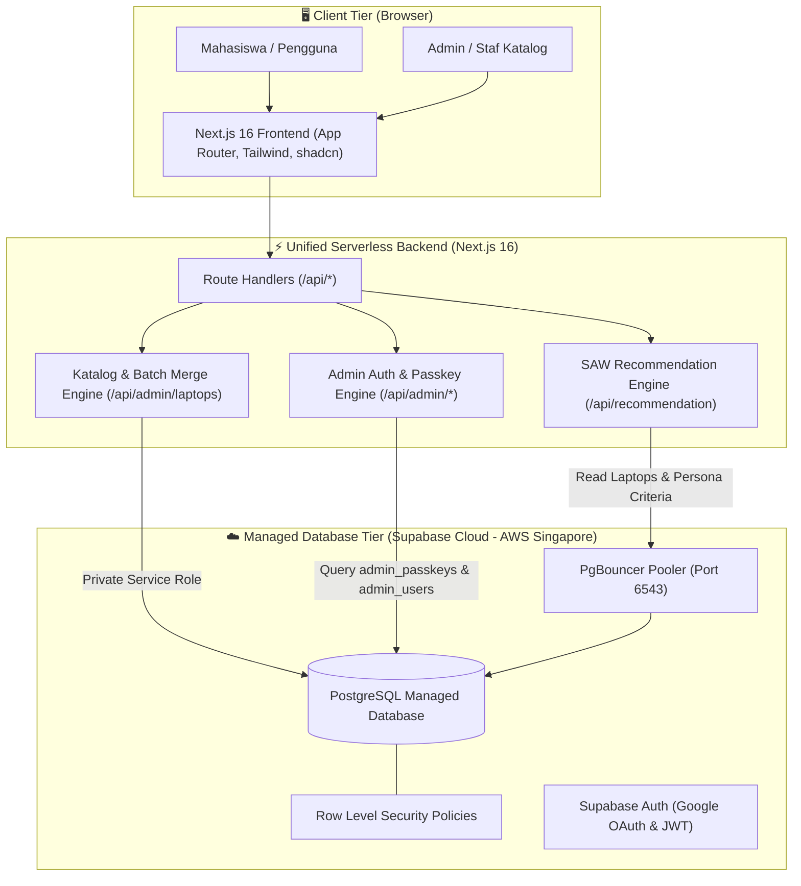
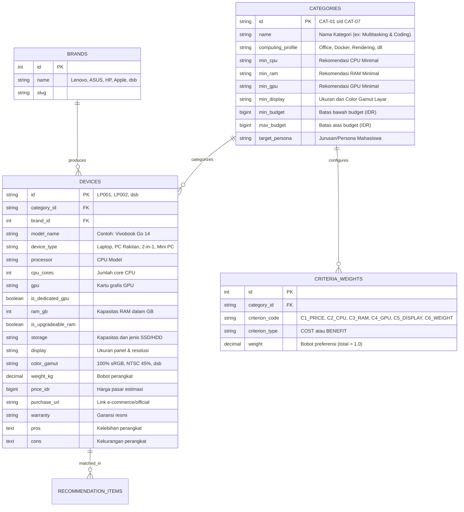

# 📐 Arsitektur Sistem & Spesifikasi Teknis SPECO

> Dokumen Arsitektur Resmi Proyek Rekayasa Perangkat Lunak (TIM SPECO - Kelompok 7A)  
> Penanggung Jawab: **Muhammad Affif (Mas Affif)** : Project Lead & Backend/Data Engineer

---

## 1. Ringkasan Sistem & Prinsip Desain

Sistem ini adalah platform **Sistem Pendukung Keputusan (SPK)** pemilihan komputer dan laptop berbasis kebutuhan beban komputasi dan anggaran mahasiswa.

### Prinsip Utama:
1. **Dynamic Branding**: Nama produk dan identitas visual bersumber dari konfigurasi dinamis `brand.config` dan environment variable.
2. **Unified Modern Serverless Architecture**: Menggabungkan antarmuka pengguna (Next.js 16 App Router) dan serverless route handlers (`/api/...`) dalam satu repositori terpadu yang terhubung langsung ke **Supabase Cloud (PostgreSQL Managed)**.
3. **Zero-Maintenance Deployment**: Menghilangkan ketergantungan pada dedicated server atau VPS mandiri (Nginx/PHP-FPM/DDEV) sehingga sistem dapat langsung dideploy ke edge infrastructure dengan ketersediaan tinggi dan biaya operasional $0.
4. **Data-Driven & Explainable**: Keputusan rekomendasi didasarkan pada metode **Simple Additive Weighting (SAW)** yang transparan dan dapat diverifikasi perhitungannya.

---

## 2. Architecture Decision Record (ADR-001): Transisi dari Laravel ke Next.js & Supabase Cloud

### Latar Belakang & Rasional Teknis:
Pada perancangan awal, backend direncanakan menggunakan PHP Laravel 12 pada container lokal DDEV. Namun, saat memasuki fase evaluasi dan deployment produksi, tim mengidentifikasi sejumlah kendala:
1. **Beban Operasional VPS/Dedicated Server**:
   Laravel membutuhkan server mandiri dengan konfigurasi OS manual: runtime PHP 8.4, PHP-FPM, web server Nginx, SSL Certbot, supervisord, dan database MariaDB lokal. Hal ini memakan biaya sewa VPS bulanan dan rawan *downtime* saat demonstrasi proyek.
2. **Overhead Latensi & Sinkronisasi CORS**:
   Pemisahan server frontend dan backend menimbulkan latensi jaringan tambahan (*round-trip latency*) dan kompleksitas konfigurasi CORS.

### Solusi yang Diterapkan:
1. **Database PostgreSQL Supabase Cloud**:
   450 data laptop dan matriks preferensi persona disimpan pada database managed Supabase Cloud kawasan Asia Tenggara (`ap-southeast-1`) dengan koneksi pooler PgBouncer, proteksi Row Level Security (RLS), dan automasi backup.
2. **Route Handlers Next.js 16 sebagai Backend Engine**:
   Logika bisnis, validasi request, kalkulasi algoritma SPK SAW, manipulasi database, serta batch import/merge Excel ditangani secara native oleh Route Handlers Next.js di sisi server Node.js dengan `SPECO_SUPABASE_SERVICE_ROLE_KEY`.
3. **Deployment Serverless Tanpa VPS**:
   Sistem dapat langsung di-deploy secara *serverless* (Vercel / Cloudflare) dengan *zero server maintenance*.

### Topologi Arsitektur Terpadu:

---

## 3. Skema Basis Data Relasional (ERD)

---

## 4. Formula Matematis Algoritma Simple Additive Weighting (SAW)

Metode SAW dipilih karena memiliki landasan ilmiah yang kokoh dalam mata kuliah Rekayasa Perangkat Lunak, memberikan hasil yang deterministik, dan mudah dijelaskan (*explainable*).

### A. Tahapan Perhitungan

1. **Filtering Mutlak**:
   Sistem menyaring perangkat alternatif ($A_i$) yang berada dalam toleransi anggaran pengguna:
   $$\text{Price}(A_i) \le \text{Budget}_{\max} \times 1.15$$

2. **Normalisasi Matriks Keputusan ($R$)**:
   Untuk setiap alternatif ke-$i$ dan kriteria ke-$j$:

   * **Kriteria Keuntungan (Benefit)** — misal: Performa CPU, Kapasitas RAM, Kualitas Layar:
     $$r_{ij} = \frac{x_{ij}}{\max_i (x_{ij})}$$

   * **Kriteria Biaya (Cost)** — misal: Harga, Bobot (semakin rendah semakin baik):
     $$r_{ij} = \frac{\min_i (x_{ij})}{x_{ij}}$$

3. **Perhitungan Nilai Preferensi ($V_i$)**:
   $$V_i = \sum_{j=1}^{n} w_j \cdot r_{ij}$$
   Dimana:
   * $V_i$ = Nilai preferensi akhir untuk alternatif perangkat $A_i$ ($0 < V_i \le 1.0$).
   * $w_j$ = Bobot kriteria ke-$j$ yang ditentukan oleh Persona/Jurusan pengguna ($\sum w_j = 1.0$).
   * $r_{ij}$ = Nilai kinerja ternormalisasi.

4. **Konversi Match Score (%)**:
   $$\text{MatchScore}(A_i) = \text{round}(V_i \times 100, 1)\%$$
