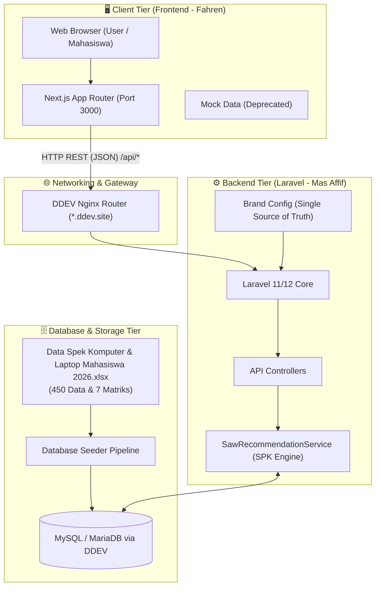
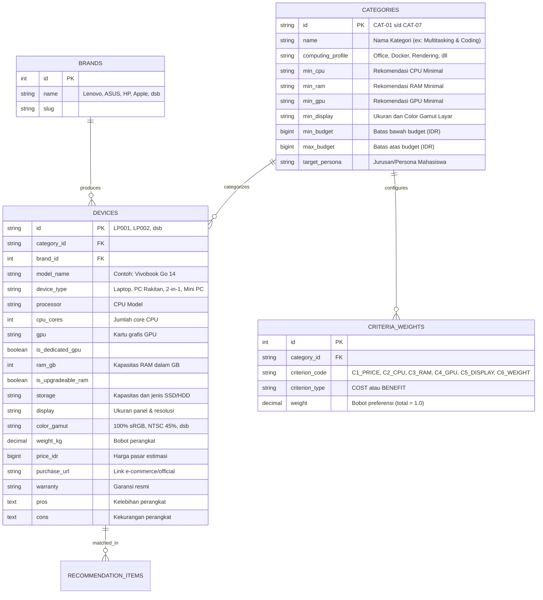

# 📐 Arsitektur Sistem & Spesifikasi Teknis Backend

> Dokumen Arsitektur Resmi Proyek Rekayasa Perangkat Lunak (Kelompok 7A - Tim NEXORA)  
> Penanggung Jawab: **Muhammad Affif (Mas Affif)** — Project Lead & Backend/Data Engineer

---

## 1. Ringkasan Sistem & Prinsip Desain

Sistem ini adalah platform **Sistem Pendukung Keputusan (SPK)** pemilihan komputer dan laptop berbasis kebutuhan beban komputasi dan anggaran mahasiswa/pengguna. 

### Prinsip Utama:
1. **Dynamic Branding**: Nama produk dan identitas visual bersifat *white-label configurable* (bersumber dari `config('brand')` / `.env`).
2. **Decoupled Architecture**: Frontend (Next.js) dan Backend (Laravel RESTful API) terpisah secara bersih (*headless*).
3. **Reproducible Local Dev**: Dijalankan di atas **DDEV** (Docker containerized) untuk konsistensi lingkungan pengembangan.
4. **Data-Driven & Explainable**: Keputusan rekomendasi didasarkan pada metode **Simple Additive Weighting (SAW)** yang transparan dan dapat dijelaskan perhitungannya (*explainable AI/SPK*).

---

## 2. Topologi Jaringan & Arsitektur Komunikasi

Berikut adalah diagram alur komunikasi antar service dalam ekosistem aplikasi:

---

## 3. Skema Basis Data Relasional (ERD)

---

## 4. Formula Matematis Algoritma Simple Additive Weighting (SAW)

Metode SAW dipilih karena memiliki landasan ilmiah yang kokoh dalam mata kuliah Rekayasa Perangkat Lunak, memberikan hasil yang deterministik, dan mudah dijelaskan (*explainable*).

### A. Tahapan Perhitungan

1. **Filtering Mutlak**:
   Sistem menyaring perangkat alternatif ($A_i$) yang berada dalam toleransi anggaran pengguna:
   $$\text{Price}(A_i) \le \text{Budget}_{\max} \times 1.15$$

2. **Normalisasi Matriks Keputusan ($R$)**:
   Untuk setiap alternatif ke-$i$ dan kriteria ke-$j$:

   * **Kriteria Keuntungan (Benefit)** — misal: Performa CPU, Kapasitas RAM, Kualitas Layar:
     $$r_{ij} = \frac{x_{ij}}{\max_i (x_{ij})}$$

   * **Kriteria Biaya (Cost)** — misal: Harga, Bobot (semakin rendah semakin baik):
     $$r_{ij} = \frac{\min_i (x_{ij})}{x_{ij}}$$

3. **Perhitungan Nilai Preferensi ($V_i$)**:
   $$V_i = \sum_{j=1}^{n} w_j \cdot r_{ij}$$
   Dimana:
   * $V_i$ = Nilai preferensi akhir untuk alternatif perangkat $A_i$ ($0 < V_i \le 1.0$).
   * $w_j$ = Bobot kriteria ke-$j$ yang ditentukan oleh Persona/Jurusan pengguna ($\sum w_j = 1.0$).
   * $r_{ij}$ = Nilai kinerja ternormalisasi.

4. **Konversi Match Score (%)**:
   $$\text{MatchScore}(A_i) = \text{round}(V_i \times 100, 1)\%$$
